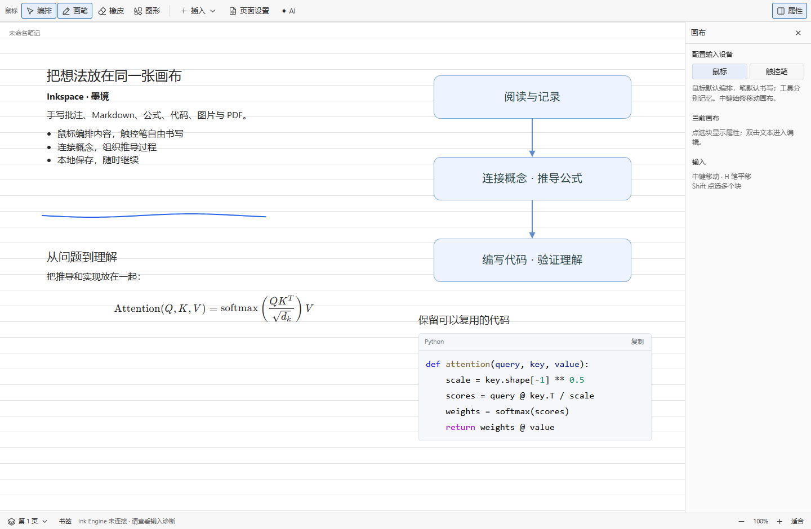

# Inkspace · 墨境

在 VS Code 中手写、阅读和编排笔记。把笔迹、Markdown、公式、代码、图片、PDF 页面和图形放进同一张无限画布。

**首个公开预览版：0.13.1 · Windows x64 · Microsoft VS Code 桌面版。** 独立 Ink Engine 随笔记自动启动，无需修改 VS Code。其他触控笔与驱动的兼容性仍需要更多用户验证。

从 [GitHub Releases](https://github.com/nollasalt/inkspace/releases) 下载 Windows x64 分发包；首发功能和限制见 [发布说明](docs/RELEASE-0.13.1.md)。

*实际界面的离线示例；展示 Markdown、公式、代码与图形，蓝色线条为合成笔迹样例。*

## 安装和使用

在 Windows x64 上安装桌面版 VS Code，运行命令面板的 **Extensions: Install from VSIX…**，选择 `Inkspace-VSCode-0.13.1-win32-x64.vsix`。

打开文件夹，文件栏右键选择“墨境：新建笔记”。首次点击“校准触控笔”，依次点击三个圆圈；同一设备与显示配置下自动恢复校准。新笔记格式为 `.ink`，采用二进制增量保存；旧 `.inkspace.json` 仍可打开。

- 触控笔书写，保留原始坐标和压力；按 V 使用鼠标左键编排对象，中键拖动画布，双击创建文本框；H 切换触控笔移动，再按 H 返回。
- 文本右侧柄调整排版宽度，字号独立设置；混合选区缩放中文字字号保持不变，支持撤销重做；默认白色背景。
- 独立画布切换、按内容拼接纸张、粘贴图片和文字、Markdown、公式、PDF。
- 缩放与移动即时显示完整轮廓，可见区域的 Cairo 位图准备好后统一替换。
- 笔记内容、视图和页面配置自动保存，保留 VS Code 保存、撤销机制。
- 页面设置可选择连续画布或 A4 竖向/横向拼接显示。
- 拖动吸附、选区对齐/等距、通用锁定、跨介质层级；底栏书签与块内部链接。

[其他电脑安装](docs/INSTALL.md) · [开发与测试](docs/DEVELOPMENT.md) · [架构](docs/ARCHITECTURE.md) · [Marketplace 发布](docs/PUBLISHING.md)

## 仓库结构

| 目录 | 用途 |
| --- | --- |
| vscode/ | 普通 VS Code 插件、Webview 适配、集成测试 |
| ink-engine/ | 独立采样传输服务、Cairo 工作进程、坐标校准 |
| native/ | Windows Raw Input、原生轮廓与 Cairo 集成源码 |
| src/、根目录前端文件 | 各宿主共用的笔记模型、笔迹和界面 |
| desktop/ | 独立桌面宿主及原生模块输出 |
| scripts/、tests/ | 构建、打包和验证 |
| docs/ | 安装、开发、发布说明与历史桌面说明 |
| theia/、vscode-native/ | 保留的 Theia、VSCodium 宿主实验 |
| dist/、artifacts/ | 安装包、测试结果与临时工作区，不纳入 Git |

保留旧宿主以便回归验证，不移动或删除用户笔记。历史独立桌面说明见 [LEGACY-DESKTOP.md](docs/LEGACY-DESKTOP.md)。

## 许可与边界

GPL-3.0-or-later，见 [LICENSE](LICENSE)。Xournal++ 轮廓算法、Cairo 与第三方依赖的来源和许可见 [native/UPSTREAM.md](native/UPSTREAM.md) 及安装包中的许可证；跨电脑分发包附对应源码。

当前只提供 Windows x64 原生运行时。后台 Raw Input 已在本机设备验证；其他笔设备仍需测试，笔尾橡皮擦尚未映射。首次安装或显示配置改变需要校准。VS Code 插件版本与根目录独立桌面版本分别管理。

A4 纸张无间隔，以淡虚线标记边界；空笔记保留首张纸，其余仅显示内容占用的纸张，笔迹、图形、文本和图片越界时自动拓展，删除后收回空纸张。

鼠标图形编辑与 draw.io 文件导入：[使用说明](docs/DIAGRAMS.md)。

## 反馈

请通过 [GitHub Issues](https://github.com/nollasalt/inkspace/issues/new/choose) 提供版本、设备型号与复现步骤。性能或保存问题可运行 **墨境：查看性能与保存诊断**，附上报告；不要上传引擎的 `connection.json` 或私人笔记。

## 可选 AI 助手

默认直接生成，需要时添加笔记数据或画面；修改先预览、再应用，并可一次撤销。需要另行安装并登录 Codex CLI，模型权限取决于账户；日常笔记不依赖 AI。详见 [AI 使用说明](docs/AI-NOTES.md)。
