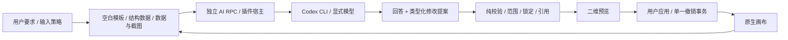

# AI 笔记助手（0.13）

目标是让 AI 理解、编写和编辑同一份多介质笔记。无需把笔迹先全部转写为文本，也不把二维图统一压成 Markdown 列表。当前在普通 Windows VS Code 插件内实现，历史桌面/Theia 宿主没有接入。

## 使用

打开 `.ink` 或旧 JSON 笔记，点击顶栏 **✦ AI**，或运行 **墨境：AI 笔记助手**。打开时暂时收起属性栏，关闭后恢复；图形等资源仍可另外打开。

1. 直接输入要求，Ctrl+Enter 发送。默认不附笔记或画面，只根据要求生成或回答；需要读取笔记时，在输入框的“添加内容”中选择选中内容或当前视野。默认只读取源码与结构；理解手写、图片、PDF 时，在同一菜单勾选“附带画面”。只有发送时联网。
2. 可以解释概念、推导公式、举例、比较、总结、制定学习步骤，或继续追问。面板没有固定任务预设，不限制任务。
3. 问答直接显示在面板，不修改笔记。“复制回答”复制 Markdown；“放入画布”在空白位置新增原生文本块，可继续编辑并一次撤销。
4. 要求编写、整理、转换或修改时，显示具体操作和二维预览。检查后点击“插入画布”或“应用修改”；所有修改进入同一个撤销事务。
5. 等待时可以继续书写。读取原稿后形成的编辑提案会在笔记变化时拒绝应用，应重新发送最新内容。仅生成只能新增，应用时在当前视野附近寻找空位，不覆盖原稿，期间书写不使其失效；切换画布时需返回原画布才能应用。移动/缩放视图本身不使提案失效。

例如：“解释这些箭头的关系，先只回答”“检查推导的第二步”“补一个反例放在原稿旁”“把选中的笔迹整理为流程图，保留原稿”“将这几个块重新排版，保留连接”。

选区附件绑定添加时的对象 ID；之后改选其他块不会改变附件。跨画布或附件对象已删除时需重新添加。改变/移除附件或切换是否附图会开始新对话，避免不附笔记时携带之前读到的内容，输入草稿保留。标题栏“新对话”同时清空附件。对话仅保留在当前编辑器会话，不写入 `.ink`；关闭或重载后清空。未应用的提案不当作笔记事实。要保留回答，请放入画布。

## 模型和运行条件

使用官方 Codex CLI 及现有登录状态，无需新增 API 密钥。默认 **GPT-6 Luna / low**；在标题栏“⋯”中可切换 **GPT-6.1 Sol / low**，展开“请求详情”查看实际模型、耗时和 token 用量。Codex 账户额度与 API 按量计价不同；本实现不收集 API 密钥，也不推算账单。

如果目标电脑没有 CLI，需要安装 Node.js，然后：

```powershell
npm install -g @openai/codex
codex login
```

CLI 通过 npm 全局安装位置自动发现；自定义原生可执行文件可用 `INKSPACE_CODEX_EXE` 环境变量指定绝对路径，重启 VS Code 后生效。CLI 不随插件分发。AI 需要联网；关闭 AI 不影响离线书写、编辑和保存。

## AI 能看到和修改什么

仅生成只发送要求、本模式对话和固定空白布局模板；模板不含实际页面 ID、正文、对象、选区或视野坐标。生成请求不访问文档、资产、选区和截图；应用时才在本地检查原稿位置，保持生成内容的相对布局并避开已有块。仅允许新增原生文本、图形和连接，不允许更新或删除已有对象。

笔记数据发送当前区域及附近的正文、几何、图形连接、分组、锁定与编辑范围，不附图。文字块的 Markdown/HTML、图形标签和真实连接直接可读；笔迹、图片、PDF 只有位置等元数据，没有正文。数据＋画面在此基础上附当前视野截图。相关连接会附带端点上下文。选区模式将截图裁剪为选区与可见视野的交集；重叠内容也会出现在图像中。选区外的文字/结构仍供上下文参考，但不能修改。不会自动扫描工作区文件或其他画布，不发送原始 PDF 文件和原始笔迹采样数组，不额外附带宿主文件路径或校准记录。

截图只覆盖可见区域。范围外的笔迹/图片/PDF 只有占位说明；多页 PDF 只看得到屏幕中呈现的部分。小窗块的源码可完整读取，但其视觉截图只含当前滚动内容。大量笔迹聚合为只读上下文，不会因整张画布已有数千条笔迹而直接拒绝；聚合的原稿不能被 AI 删除或移动，选择数据＋画面后可理解可见笔迹并在旁边生成识别结果。当前限制为一次上下文最多 600 个对象、约 900 KB 结构数据，单次提案最多 200 个操作。

原生文本块、常用图形和连接支持新增/修改/删除；图片、PDF 单页、笔迹、旧手绘形状可以移动、调整尺寸或删除，但不能凭空生成其资产。图片保持原比例。图形连接复用原有四边连接点和避障路由。锁定对象和范围外对象不接受修改。删除节点还必须显式处理它的连接。

默认提示要求保留用户未要求删除的笔迹和原始资产，识别结果通常放在原稿旁。模型可能误读手写、公式或箭头；预览不是正确性证明。没有将合成识别样本的通过当作真实复杂笔迹的准确率。

## 架构



| 模块 | 职责 |
| --- | --- |
| `ai/models.cjs`、`ai/codex-client.cjs` | 显式模型、CLI 发现、取消、超时与结构化响应；识别 demo 复用同一传输 |
| `ai/schema.cjs`、`ai/instructions.txt` | 输出协议及助手职责；笔记中的指令视为数据 |
| `src/ai/proposal.cjs` | 纯数据校验与修改计划，不操作 DOM、文件或输入 |
| `src/ai/input.cjs` | 三种输入策略、固定空白模板、仅生成的本地放置 |
| `src/ai/context.cjs` | 空间相关上下文、连接闭包和大量笔迹的只读聚合 |
| `src/ai/canvas-adapter.js` | 原生块/图形 ↔ 稳定场景模型；事务提交与原稿一致性检查 |
| `src/ai/canvas.js`、`preview.js` | 对话、截图、结构预览及用户操作，不接管笔迹采样 |
| `src/ai/panel.js` | 精简侧栏布局、附件菜单和折叠的模型/请求详情 |
| `vscode/ai-controller.cjs`、`ai-host.cjs` | 每个编辑器的请求生命周期、临时上下文、模型调用；不进入保存队列 |

模型不能执行 shell、浏览器、插件或文件编辑工具。CLI 在临时空目录中运行，忽略用户项目配置与记忆，采用只读沙箱和临时会话。生成结果先后在宿主和画布校验，绝不直接覆盖整个笔记文件。临时图像/协议/输出在请求结束或取消后删除。

读取笔记的请求将完整原稿的一致性比较保留在本地，包含笔迹压力和图片资产；不只比较包围盒或文字长度。应用前先完成当前编辑，再验证原稿和作用范围；拒绝过期结果。仅生成不读取源文档快照，应用时验证目标画布及只允许新增的约束，不会覆盖等待期间的书写。宿主独立强制执行输入策略，非画面模式拒绝图片，仅生成丢弃意外夹带的文档字段。原生事务同步提交并在异常时恢复文档和历史。AI 不注册新的画布指针监听，辅助面板的键盘及粘贴由自身拥有。

新增介质时应扩展结构能力与确定性适配器，而非让模型输出任意 JavaScript、mxGraph XML 或直接修改 `.ink`。现阶段没有无人值守自动改写、全工作区代理、增量后台识别或专用布局求解器。

## 验证

`npm run test:ai` 检查范围/锁定/引用、原生控件、内容修改保持宽度、一次撤销、旧笔迹提案拒绝、真实截图与选区裁剪、对话、回答插入及 UI 所有权；还检查默认无图、仅生成不访问文档及不泄漏结构、切换模式清空历史、显式附图、生成期间继续编辑与本地放置。`npm run test:engine:workbench` 在普通 VS Code 和独立引擎内验证 AI RPC、截图、原生提案、撤销、二进制保存和重开。两者不向云端发送内容。

`npm run test:ai:codex` 是显式联网的合成测试，仅发送源码内的测试文字；检查 Luna 文字修改与问答，并记录实际耗时。真实手写、密集公式和复杂 Mindmap 需要继续实测。

## 代码显示

画布 Markdown 围栏/缩进代码、HTML 的 `pre > code`、AI 回答与提案预览共享 `src/code-highlight.js`、`src/code-grammar.js` 和 `src/code.css`。0.13.1 改用 [Shiki](https://shiki.style/guide/) 的上游 TextMate 语法与 VS Code Light+/Dark+ 主题，语法类别及颜色不再由本项目手写维护。使用 JavaScript 引擎，无需额外 WASM 或运行时网络请求。覆盖常见语言及 PowerShell、Dockerfile、LaTeX、JSX/TSX、JSONC、CUDA 别名。

显式语言优先；无语言或未知语言由 highlight.js 判断，低置信度时使用 JavaScript 语法做通用词法着色并标记“通用”，不会假称已确定语言，也不会因分数低就丢掉全部高亮。`text`/`plaintext`/`nohighlight` 可以明确关闭识别。大于 100 KB 的单块保留原文显示以限制同步解析时间。语法引擎和单语言按需初始化，输出 LRU 缓存，移动/缩放和书写不重复解析。不会修改保存的源码。

语言标签和复制入口不计入源码字符映射，复制只取代码正文。代码工具条的鼠标按下由统一输入路由分配，触控笔与中键仍用于书写/平移，不增加文档历史。笔记白纸代码使用浅色配色，AI 回答跟随 VS Code 主题。当前是代码阅读高亮，块内源码编辑仍使用原有文本编辑会话，不引入新的编辑器或改变撤销协议。
