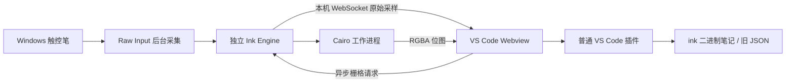

# 当前架构

0.13 的 [AI 笔记助手](AI-NOTES.md) 通过独立 RPC 返回回答及类型化修改；界面为对话与可选附件，默认只生成。附选区或视野时读取数据，显式勾选才截图。输入策略仍独立为仅生成、笔记数据、数据＋画面。仅生成使用空白模板，不读取原稿，应用时才在本地放置新增内容。纯计划校验、原生适配器、预览和同步事务分开实现。推理不进入保存队列或笔迹路径，大量笔迹可聚合为只读上下文。AI 不直接重写 `.ink`，原稿一致性校验保留在本地。

`src/code-highlight.js`、`src/code-grammar.js` 与 `src/code.css` 为 Markdown、HTML 与 AI 输出提供共享代码视图；源码仍由各介质持有。TextMate 语法和 Light+/Dark+ 主题由 Shiki 提供；highlight.js 仅用于未指定语言时的判断，低置信度使用通用着色。语法引擎与语言按需初始化，结果缓存。语言/复制工具条不参与源码字符映射。复制控件只在编排时消费鼠标事件，笔和中键继续由统一路由处理；剪贴板写入由宿主注入，重复安装只更新宿主配置。

当前产品边界见 [产品范围](PRODUCT-SCOPE.md)。普通 VS Code 是唯一持续维护的发布宿主；其他宿主保留历史代码。`src/interaction/tools.ts` 管理独立的鼠标/笔工具偏好，`machine.ts` 管理唯一接触手势，二者不混入文档历史。`media-sizing.ts` 统一尺寸策略：文本重新排版，视觉介质等比缩放；同一策略用于实时预览与事务提交。

普通 VS Code 扩展注册 `.ink` 二进制 Custom Editor、旧 `.inkspace.json` 文本 Custom Editor 和画布树。打开笔记时检查本机服务，必要时启动随插件打包的 Ink Engine。`.ink` 采用追加式二进制增量保存及合并自动保存；旧 JSON 编辑器使用 TextDocument API。

服务仅监听 127.0.0.1，使用随机令牌鉴权。采样、Cairo 绘制和 IDE 插件分开运行，不注入 IDE 窗口，不修改 VS Code 安装文件。

校准将 HID 原始坐标映射到屏幕坐标。持久化记录按稳定的设备路径标识和显示配置匹配；运行时设备句柄改变不影响恢复。浏览器指针用于校准和窗口坐标偏移，书写轨迹使用 HID 原始坐标与压力。

移动和缩放时，未就绪的可见区域立即显示缓存的 Xournal++ SVG 轮廓预览。Cairo 位图全部准备好后统一替换，避免逐笔加载。常见笔迹完整位图在相同倍率下复用，较大笔迹裁剪到视口以控制内存。

历史独立桌面和 VSCodium 宿主使用 Windows Pointer/HIMETRIC 路线；Theia 和这些宿主保留用于参考与回归，不是普通 VS Code 插件的运行依赖。

块模型、输入交互与介质渲染的分层，以及 PDF 单页资产、文本格式和避障路由边界，见 [块架构](BLOCKS.md)。

画布输入由统一状态机分配所有权，渲染器只提供效果；模块职责、取消与扩展契约见 [交互架构](INTERACTION-ARCHITECTURE.md)。

## 编排与导航（0.11）

`snapping.ts` 是无 DOM 的世界坐标算法，容差固定为 6 屏幕像素。`arrangement.js` 提供几何、对齐/等距、锁定、稳定引用与显示/命中排序；普通选择和 mxGraph 原生拖动复用同一个吸附服务。图形的 SVG/HTML 节点进入每个图形独立的显示容器，仍由 mxGraph 更新；不复制渲染快照、不重新栅格化墨迹。PDF、文本、图片与图形共用显示层级，墨迹保留独立的最上方标注层。

`transactions.js` 合并嵌套命令中的检查点并在同步异常时恢复原稿和历史。移动、调宽、选区缩放只更新预览，完成才创建检查点；未改变尺寸/位置不产生撤回记录。Esc/失焦丢弃编排预览；切换画布/工具及显式保存先完成当前操作。输入中断保留已经收到的真实笔迹。

画布文档的 `blockState` 是稳定引用附加的锁定和内部链接，`blockOrder` 保存介质显示顺序，`bookmarks` 保存命名世界坐标区域。更新均替换数组，与快照历史及二进制增量保存兼容；增量捕获额外复制这些小型元数据。复制块时重映射块 ID、保留指向原书签的内部链接，不复制整张画布的书签。`places.js` 负责区域管理和跳转，复用导航历史，删除目标后给出失效提示。
