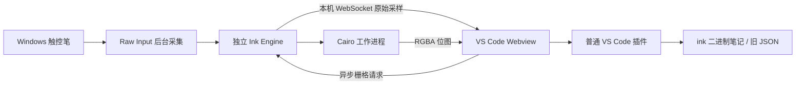

# 当前架构

普通 VS Code 扩展注册 `.ink` 二进制 Custom Editor、旧 `.inkspace.json` 文本 Custom Editor 和画布树。打开笔记时检查本机服务，必要时启动随插件打包的 Ink Engine。`.ink` 采用追加式二进制增量保存及合并自动保存；旧 JSON 编辑器使用 TextDocument API。

服务仅监听 127.0.0.1，使用随机令牌鉴权。采样、Cairo 绘制和 IDE 插件分开运行，不注入 IDE 窗口，不修改 VS Code 安装文件。

校准将 HID 原始坐标映射到屏幕坐标。持久化记录按稳定的设备路径标识和显示配置匹配；运行时设备句柄改变不影响恢复。浏览器指针用于校准和窗口坐标偏移，书写轨迹使用 HID 原始坐标与压力。

移动和缩放时，未就绪的可见区域立即显示缓存的 Xournal++ SVG 轮廓预览。Cairo 位图全部准备好后统一替换，避免逐笔加载。常见笔迹完整位图在相同倍率下复用，较大笔迹裁剪到视口以控制内存。

历史独立桌面和 VSCodium 宿主使用 Windows Pointer/HIMETRIC 路线；Theia 和这些宿主保留用于参考与回归，不是普通 VS Code 插件的运行依赖。

块模型、输入交互与介质渲染的分层，以及 PDF 单页资产、文本格式和避障路由边界，见 [块架构](BLOCKS.md)。
