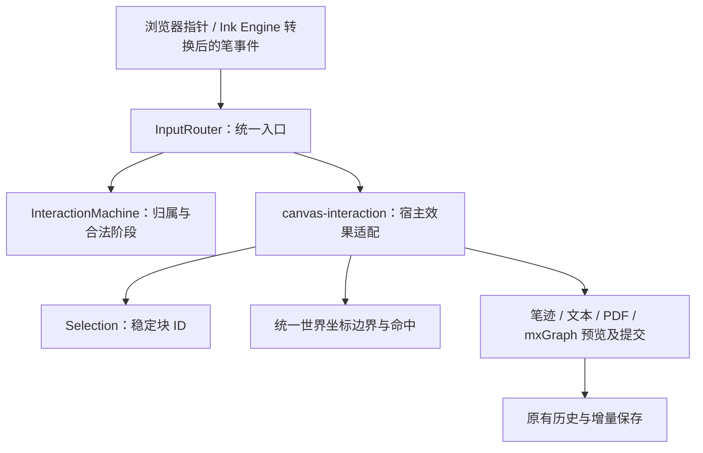

# 交互架构（0.8.0）

本轮重构以交互所有权为核心。一个画布手势只能由一个会话处理，渲染器只提供布局、预览和提交效果。保留普通 VS Code 插件、独立 Ink Engine、现有笔迹缓存、mxGraph 和 `.ink` 文件格式。

## 入口与职责

| 模块 | 负责 | 不负责 |
| --- | --- | --- |
| `src/interaction/machine.ts` | 纯输入策略、唯一手势所有者、合法阶段、连接与编辑状态 | DOM、渲染、文件 |
| `src/interaction/router.ts` | 指针捕获、事件派发、取消、快捷键入口、mxGraph 完成确认 | 块布局、修改文档 |
| `src/interaction/selection.ts` | 稳定 `kind/id` 选区，旧索引接口的兼容投影 | 绘制选框、图形事件 |
| `src/interaction/geometry.ts` | 包含/框选判断；从文本渲染适配器读取实际可见框 | 文本排版、输入决策 |
| `canvas-interaction.js` | 将会话转换为预览、提交、取消；集中处理画布手势 | 直接读取原始 HID、磁盘写入 |
| `block-interaction.js` | 根据统一边界命中，提供连接目标与临时控件 | 独立监听画布拖动 |
| `renderer.js`、`vscode/inline-text.js`、`src/diagram.js` | 渲染、内容编辑、已有缓存与图形编辑效果 | 与其他介质争抢画布指针 |

`app.js` 仍持有文档、视口、历史及公共几何操作；本轮将输入决策移出这些效果函数，并非重写全部渲染与存储代码。`active` 是兼容的效果载荷，所有者以状态机为准，不再让各介质依据 `active` 自行接管事件。

## 会话与优先级

画布手势为 `ink / erase / shape / pan / selection / text-scale / width / height / connection / view-toggle / diagram`。选择会话从按下进入拖动、框选或缩放；绘制、移动、调整尺寸与图形委托只允许对应阶段。第二个指针不能抢走正在执行的手势；双指平移/缩放允许同一触摸会话收纳两个指针。

文本编辑状态和待完成连接独立于按下手势：连接可以等待下一次点击，文本编辑器可继续接受键盘输入，触控笔仍可在其上书写。此处的“独立”不允许两个画布拖动同时修改同一内容。

按下时依次判定：重复的浏览器笔事件与掌触过滤；真实输入界面；中键/空格/触摸平移；所选绘制工具；明确控件或待完成连接；mxGraph 委托；内容点选或空白框选。绘制工具穿透文本、图片与图形控件。笔悬停不显示鼠标控件。悬停只显示界面，不取得手势所有权。

鼠标控件必须命中实际按钮矩形。悬停桥接区不是连接热点；一个块的外置箭头覆盖邻近文本框时，邻近内容优先获得点选。顶部拖动条仍可从内容框之外开始拖动。

mxGraph 保留自己的图形编辑实现，但 `fireMouseEvent` 只有获得 `diagram` 委托后才能进入。不能在 `pointerup` 的微任务中提前释放归属，必须等待兼容 `mouseup` 完成图形提交并确认结束。

## 同一边界与稳定选区

文本有排版宽度、可见内容框及临时编辑窗口三个不同尺寸。整体缩放不修改排版宽度；编辑窗口可暂时扩大，可见块的位置和连接边界保持原位。点选、框选、公共选择框和连接端点使用同一世界坐标边界；拖动/缩放中的连接另读取同一边界的预览变换。

文本实际灰框由 `noteFrame` 从渲染器的 CSS 尺寸读取，缓存局部几何，视口或块变换时换算世界坐标。按钮的屏幕尺寸依旧固定。无 DOM 布局的宿主和测试保留模型边界回退。

选区只保存稳定 ID。索引数组与 mxGraph 选择是现有操作接口的投影，避免插入、删除和重排后选择错误对象。索引缓存复用前验证所选对象 ID；被删除的引用不匹配替代对象，撤销恢复相同 ID 后重新解析。

## 提交与取消

点选没有撤销记录。超过 3 屏幕像素才启动移动；预览变换已有图层，释放时提交一次。调整宽度等原有操作继续使用历史检查点；会话保存首次检查点及原历史/重做列表，Esc 取消时还原，历史已达 80 条上限也不丢失原记录。

失去窗口焦点、指针取消和真正丢失捕获必须结束归属。笔迹和橡皮在这些非主动取消情况下保留已接收输入；Esc 主动取消则恢复检查点。旧捕获释放事件若在新捕获之后送达，不取消新手势。切换文档、工具及外部完成操作统一清除手势和临时效果。

## 接入新介质

新增介质首先实现模型枚举、稳定 ID、持久化/复制校验，再提供世界坐标边界、内容渲染、编辑入口和预览效果。移动、缩放、组合、菜单和连接复用公共操作。

介质不新增画布 `pointerdown/move/up` 捕获链；新控件在统一控件表与输入策略中声明。内容编辑器可以处理自己的键盘、文本选取与滚动，但必须通过入口暴露准备/完成方法，避免靠监听注册顺序获得优先级。连接使用现有四向法向端点与正交避障。

## 验证

`npm test` 包含交互核心严格类型检查、纯状态机策略、合法转移、稳定选择与现有模型/渲染/文件检查。`npm run test:ownership` 用实际 Chromium 鼠标事件验证 45 组内容/倍率边界、9 组邻近箭头覆盖、取消移动、满历史取消宽度调整以及连接预览/提交一致性。原有 `test:blocks`、`test:interaction`、`test:text:mouse`、`test:text:caret` 与 `test:engine:binary` 继续覆盖图形委托、内容编辑和笔迹性能。

测试鼠标拖动必须携带持续按下的按钮状态，否则 Chromium 会正确地丢失指针捕获。`tests/mouse-input.cjs` 统一处理注入事件，生产代码继续响应真实捕获丢失。真实笔设备的校准、压力与感受仍需实机书写确认。
